### Hi there, I'm Hai-Long 👋

- 😊 I am currently with the <a href="https://www.ant-ling.com/zh/" target="_blank">Ant Ling Team</a> at Ant Group (**Ant Star - Plan A Program**).
Prior to joining Ant Group, I received my M.Sc. degree from the <a href="https://ai.nju.edu.cn/" target="_blank">School of Artificial
Intelligence</a>, <a href="https://www.nju.edu.cn/main.htm" target="_blank">Nanjing University</a>, in 2026,
under the supervision of Prof. <a href="http://www.lamda.nju.edu.cn/yehj" target="_blank">Han-Jia Ye</a>.
During my graduate studies, I was a member of the
<a href="http://www.lamda.nju.edu.cn/MainPage.ashx" target="_blank">LAMDA Group</a>, led by Prof.
<a href="http://www.lamda.nju.edu.cn/zhouzh/" target="_blank">Zhi-Hua Zhou</a>. 
- 🎓 My research interests include Machine Learning and Data Mining. Currently, I focus on **Multimodal Foundation Models**, **Multimodal Agent and Coding**, and **Continual Learning**.
- 🔭 Find more information about me on my [personal page](https://www.lamda.nju.edu.cn/sunhl/).
- 📫 Contact me via sunhl@lamda.nju.edu.cn, welcome to collaborate and communicate!

 
